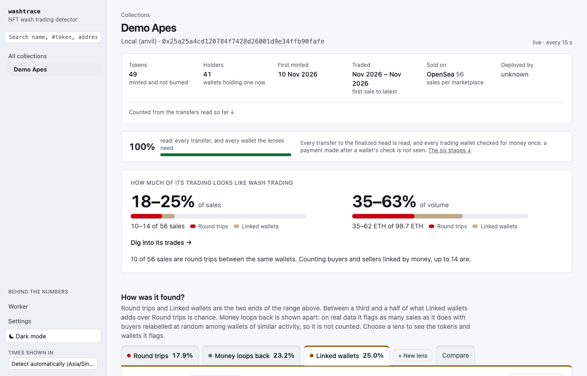
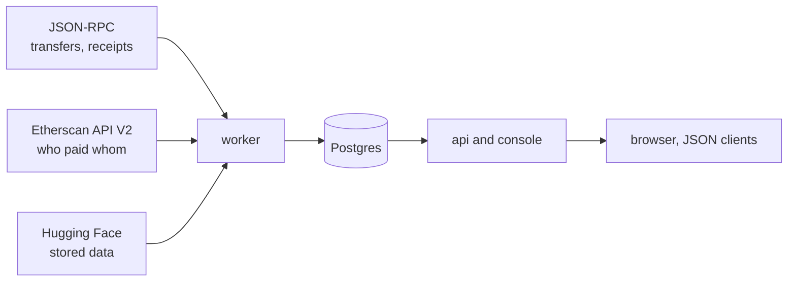

# washtrace

**Finds NFT wash trading on any EVM chain by following the money between wallets,
and says why each trade was flagged.**

Wash trading is trading with yourself: the same person on both sides of a sale,
to fake volume, prop up a price or farm a marketplace's rewards. washtrace reads
every transfer of the collections you watch and who paid whom among the wallets
that traded them, and judges each trade by three graph methods. It runs as two
services over one Postgres: a polling **worker** and a JSON **API** with a
console.

It is the 2023 paper [*Detecting and quantifying wash trading of non-fungible
tokens*](paper/chow-2023-detecting-and-quantifying-nft-wash-trading.pdf) (Chow)
rebuilt on today's systems: the methods are the paper's, the data sources,
marketplaces and three corrections are new.

- **Status:** v0.1.0. Tested against Postgres 17 and anvil 1.5.1; verified on
  Ethereum mainnet against the paper's own example sale.
- **Try it:** the [demo](#quick-start) needs Docker and no keys.
- **Data:** [jonathanmiro97/washtrace-data](https://huggingface.co/datasets/jonathanmiro97/washtrace-data)
  on Hugging Face: six Ethereum collections read from the chain, CC-BY-4.0.
- **Docs:** [how the methods work](doc/methods.md), [the console](doc/console.md),
  [operating it](doc/operating.md), the [API](doc/api.md), and
  [CONTRIBUTING.md](CONTRIBUTING.md) for working on the code.



## Quick start

Requires Docker with Compose 2.24 or later.

**The demo needs no keys.** It runs a local chain with a scripted market, wash
trading of each kind hidden among honest trades:

```sh
docker compose -f docker-compose.yml -f docker-compose.demo.yml up --build
```

Open http://localhost:8080 and choose **Demo Apes**. Its verdicts arrive about
seven minutes after the seeder finishes: the worker reads the transfers within a
minute, but analyses of one collection are spaced five minutes apart, and the
first ran before any transfer was read. Each token below is one scenario, and [doc/methods.md](doc/methods.md)
walks through why each verdict is what it is.

| Token | What happens | Round trips (A) | Money loops back (AU) | Linked wallets (AC) |
|---|---|---|---|---|
| #101 | Sold back and forth between two wallets | flagged | flagged | flagged |
| #102 | Sold round a ring of three wallets, twice | flagged | flagged | flagged |
| #111 | The buyer pays the seller back | – | flagged | flagged |
| #112 | The buyer pays the seller back through a third wallet | – | flagged | flagged |
| #113 | The money comes back through three wallets that never traded | – | flagged | – |
| #114 | One wallet funded both the seller and the buyer | – | – | flagged |
| #116 | The seller and the buyer both paid the same wallet | – | – | flagged |
| #1–#40 | Honest sales, every buyer funded by one exchange | – | – | – |
| #120 | Two loans through Blur Blend, then a sale | – | – | – |
| #130 | Sold once and bought back once | – | – | – |

**Against a real chain**, give it an RPC endpoint and an Etherscan key:

```sh
cp .env.example .env    # set WASHTRACE_RPC_1 and WASHTRACE_ETHERSCAN_KEY
docker compose up --build
```

Then watch a collection from the console, or `POST /api/collections`. A big
collection takes days to read from the chain; [how it works](#how-it-works) says
what the worker reads, in what order.

**With no keys**, skip the `cp` and watch one of the six collections in [the
dataset](#the-dataset). Argonauts is the smallest download, about 320 MB:

```sh
curl -X POST http://localhost:8080/api/collections -H 'content-type: application/json' \
  -d '{"chainId": 1, "address": "0x387c41b0b2f1128de44db1bcf8baad085f26392c"}'
```

The worker downloads it and warns that no RPC is set, so only stored data is read
until one is set in Settings.

The console and API are on port 8080 of this machine only.

## Asking for a verdict

Everything the console shows is JSON under `/api`. A transaction's verdict, here
the demo's sale of #114 (its hash is on the token's page), trimmed:

```sh
curl http://localhost:8080/api/transfers/31337/0x083d0b4dc33d0b699b212e551c5195e31efbef22b285456be6c2181f97b05470
```

```jsonc
{
  "washTrade": true,   // Round trips or Linked wallets flags it
  "judged": true,      // an analysis covers it; false means "not judged yet", never clean
  "methods": ["AC"],   // every lens that flagged it
  "transfers": [{
    "tokenId": "114",
    "from": "0x72f1…ebf6",
    "to": "0x28ed…f31b",
    "marketplace": "seaport-1.6",
    "priceWei": "9000000000000000000",
    "flags": {
      "AC": {          // the witness: why Linked wallets flagged it
        "kind": "pair",
        "pair": ["0x72f1…ebf6", "0x28ed…f31b"],
        "middle": "0x8318…67d8",  // the wallet that paid both
        "flowTx": "0xc924…05f9"   // a payment that joins them
      }
    }
  }]
}
```

A transaction washtrace has not read is 404, never `washTrade: false`. Every
route, with its status codes and keys, is in [doc/api.md](doc/api.md).

## How it works



The worker does the reading, on timers:

1. **Ingest** loads a collection's stored data if the dataset has it, then reads
   its ERC-721 transfers forward to the finalized head. A transfer in a known
   marketplace's transaction is a sale, priced from that marketplace's logs
   where it can be.
2. **Fund** reads who paid whom for every wallet that traded, busiest first,
   then follows that money out to wallets that never traded the collection.
3. **Analyze** runs the three methods, and your lenses, whenever a collection's
   data has changed.

The api and console only read Postgres; neither calls a chain. So a slow read
never slows a page, and either service can be restarted or scaled alone.

## The methods

Each method flags transfers. A collection's **share** is the part of its trades
a method flags: the collection page leads with the share of sales, and the share
of changes of owner is the paper's Tables 3 and 4. The console uses the names in
the first column; the paper's are in brackets.

| Method | Flags a transfer when | Needs who paid whom |
|---|---|---|
| **Round trips** (SCC A) | It lies in a strongly connected component of the token's own transfer graph with at least two cycles: wallets passing the token back and forth. | No |
| **Money loops back** (SCC AU) | It lies in a component of the token's transfers joined with the directed graph of money between its holders, where the money can run up to 30 wallets deep. A component closed by money counts on one cycle. | Yes |
| **Linked wallets** (SCC AC) | Round trips flags it, or its two wallets are joined by money within two hops in either direction: one paid the other, or both share a funder, a sink or a middle. | Yes |

Every flag carries a witness (the component and its cycle count, or the pair and
what joins them), shown as a sentence and returned as data. A method that needs
who paid whom and has none reports itself **not run**, never 0%.

**The headline is a range, from Round trips to Linked wallets.** Money loops
back still runs and keeps its card, but is not counted: in a placebo test, with
buyers relabelled at random among wallets of similar activity, it flagged as many
sales as with the real buyers (Terraforms 71.7% against 74–75%, dotdotdot 59.5%
against 58–59%). Linked wallets clears the same test, though between a third and
a half of what it adds over Round trips is chance. The test, the thresholds and
each method on a demo token are in [doc/methods.md](doc/methods.md).

## The paper

**[*Detecting and quantifying wash trading of non-fungible tokens*](paper/chow-2023-detecting-and-quantifying-nft-wash-trading.pdf)**
by Jonathan Chow, Singapore Management University, 2023
([slides](paper/chow-2023-detecting-and-quantifying-nft-wash-trading-slides.pdf), 25 slides).

The paper starts from an observation: the top NFT collections by market cap
show far less wash trading than the rest. That points to wash trades the usual
detector cannot see. The usual detector finds strongly connected components
(SCCs) in a token's own transfers, and a trader beats it by paying through
wallets that never touch the token. The paper adds the graph of money between
wallets to the token's transfers, and from the two builds the three methods
above.

### From the paper to now

| | The paper (2023) | washtrace |
|---|---|---|
| Data sources | Moralis, Footprint Analytics | Any JSON-RPC endpoint, Etherscan API V2 |
| Chains | Ethereum | Any EVM chain |
| Marketplaces | Seaport 1.4 and 1.5 | Seaport 1.1 to 1.6, Blur, LooksRare v2, X2Y2 |
| Money | ETH | ETH, internal transfers, WETH, Blur Pool, and Other tokens if read |
| Whose money | Traders' | Traders', then followed out (`follow.hops`), so SCC AU's depth 30 reaches outside the collection |

Only finalized blocks are read, so a stored transfer is never retracted.

Three corrections, each with a test:

- **The payment leg of a sale is not money closing a cycle.** Flows sharing a
  transaction with a transfer are excluded.
- **Custody is not a change of owner.** A Blend loan A → Blend → A is not a round
  trip.
- **An exchange is not a common funder.** A wallet joined by money to more than
  20 of the collection's wallets (`hubDegree`), a known contract, or a wallet
  with more history than Etherscan pages through cannot be the middle of an SCC
  AC path.

### The work it builds on

- Jung (2022), [*Towards a Web Application to Detect and Analyze Wash Trading in NFT Collections on the Solana Blockchain*](https://wwwmatthes.in.tum.de/file/19apj4nvq7a8m/Sebis-Public-Website/Student-Theses-Guided-Research/Current-Theses-Guided-Researches/TUMKolleg-Sebastian-O.-Jung/Sebastian%20Jung%20Thesis.pdf), TUM: SCC detection on each token's transfer graph, flagged by cycle count: the basis of SCC A.
- Liu (2023), [*NFT Wash Trading Detection*](https://arxiv.org/abs/2305.01543): SCC detection over sales as well as transfers.
- hildobby (2022), [*Ethereum NFTs Wash Trading*](https://dune.com/hildobby/nfts-wash-trading), Dune: a buyer and seller first funded by the same wallet, which SCC AC generalises.
- Victor & Weintraud (2021), [*Detecting and Quantifying Wash Trading on Decentralized Cryptocurrency Exchanges*](https://arxiv.org/abs/2102.07001): SCC detection over the user transaction graph, here applied to money between NFT traders.
- Cao et al. (2016), [*Detecting Wash Trade in Financial Market Using Digraphs and Dynamic Programming*](https://ieeexplore.ieee.org/document/7298451): wash trades as cycles in a directed graph; its volume matching does not carry over, as NFTs are not fungible.

The standards and sources washtrace reads: [ERC-721](https://eips.ethereum.org/EIPS/eip-721),
[Seaport](https://github.com/ProjectOpenSea/seaport) (whose sales it prices) and
[Etherscan API V2](https://docs.etherscan.io/) (who paid whom).

## The console

Each collection's page leads with the share of its sales that looks washed, as
the range from Round trips to Linked wallets, with a tab per lens. From there,
every figure opens the trades, tokens or wallets it counts, and a token's page
draws its graph as in the paper's Figure 8. You can also write **your own
lens**: which payments may carry the money back to the seller, through how many
wallets, in what time window. Preview tries it on 2,000 sales before you save.
The pages, the words the console uses and the lens editor are in
[doc/console.md](doc/console.md).

## The dataset

Reading a big collection from the chain takes days, so its data is cut once and
published to Hugging Face. When you watch a collection the dataset holds, the
worker downloads it, loads it, then reads on from the chain. The default dataset
holds six Ethereum collections, read through block 26299951 (October 2026):

| Collection | Address | Transfers | Money trail |
|---|---|---|---|
| Argonauts | [`0x387c…392c`](https://etherscan.io/address/0x387c41b0b2f1128de44db1bcf8baad085f26392c) | 1.3 MB | 321.0 MB |
| Terraforms | [`0x4e1f…0e56`](https://etherscan.io/address/0x4e1f41613c9084fdb9e34e11fae9412427480e56) | 2.9 MB | 621.8 MB |
| Meebits | [`0x7bd2…6bc7`](https://etherscan.io/address/0x7bd29408f11d2bfc23c34f18275bbf23bb716bc7) | 6.3 MB | 997.0 MB |
| Dreadfulz | [`0x81ae…5aa8`](https://etherscan.io/address/0x81ae0be3a8044772d04f32398bac1e1b4b215aa8) | 1.6 MB | 368.2 MB |
| BoredApeYachtClub | [`0xbc4c…f13d`](https://etherscan.io/address/0xbc4ca0eda7647a8ab7c2061c2e118a18a936f13d) | 10.9 MB | 955.8 MB |
| dotdotdot | [`0xce25…92c3`](https://etherscan.io/address/0xce25e60a89f200b1fa40f6c313047ffe386992c3) | 1.0 MB | 414.8 MB |

Each file is zstd-compressed CSV; a money trail is two files, and the table adds
their sizes. The [dataset card](https://huggingface.co/datasets/jonathanmiro97/washtrace-data)
gives the columns and a pandas example. How the worker loads it is in
[doc/stored-data.md](doc/stored-data.md).

## Configuration

Both services read the same variables; in Compose they share one `.env`, and
[.env.example](.env.example) lists them all. A setting saved in the console wins
over `.env` and applies from the worker's next pass. The ones to set first:

| Variable | Purpose |
|---|---|
| `WASHTRACE_RPC_<chainId>` | JSON-RPC URL per chain, such as `WASHTRACE_RPC_1`. |
| `WASHTRACE_ETHERSCAN_KEY` | Etherscan API V2 key, one for every chain. Without it, Money loops back and Linked wallets use only a stored money trail. |
| `WASHTRACE_FOLLOW_HOPS` | Hops of money followed out of a trader. Default 3; 0 reads traders only, as the paper did. |
| `WASHTRACE_USERNAME`, `WASHTRACE_PASSWORD` | Basic auth, for any host other than your own machine. |

Every variable and console setting is in [doc/operating.md](doc/operating.md#settings).

## Deploying

The [Dockerfile](Dockerfile) builds two images (`--target worker` and
`--target api`), and [docker-compose.yml](docker-compose.yml) runs them over
Postgres 17. Both migrate the schema on boot. On a public host, set
`WASHTRACE_USERNAME` and `WASHTRACE_PASSWORD`: without them every write is
accepted only from the machine itself. Health checks, scaling, shutdown and the
worker's four jobs are in [doc/operating.md](doc/operating.md); what each
migration does at boot is in [doc/upgrading.md](doc/upgrading.md).

## Known limits

- **Money is followed one way.** The worker follows money out of each trader,
  `follow.hops` deep, only through wallets that paid at most 25 others
  (`FOLLOW_FANOUT`). Following is what finds demo token #113's way back, but an
  exchange or a busy trader is not followed, so a path back through one stays
  unseen.
- **Reads are a snapshot unless read again is on.** A wallet's money and Other
  tokens are read once, so a later payment is not seen. `follow.reread` reads a
  trader again when it trades again; wallets loaded from a stored money trail
  and wallets past Etherscan's 10,000-row page limit are never read again. See
  [doc/operating.md](doc/operating.md#reading-traders-again).
- **Other tokens are a fixed list** in the code, not the settings, and without
  `tokens.payees` a loop whose middle wallet was only paid in tokens can be
  missed.
- **Searches have caps.** A trade's money search stops at 5,000 edges and the
  share reads "at least"; a lens run holds at most 40 million money edges. All
  the caps are in [doc/operating.md](doc/operating.md#limits).
- **Funding is slow on purpose:** four Etherscan calls per wallet at four a
  second, so 30,000 wallets take about eight hours.
- **Sales on Blur, LooksRare v2 and X2Y2 are marked but not priced.** Blur v2
  packs the price into bit fields washtrace does not decode, and a guess would
  count as read volume. Their sales count; their volume does not.
- **ERC-1155 is not read.** The method depends on one token, one holder.

## Reference

- [The methods](doc/methods.md): each method on a demo token, what is never
  counted, the thresholds, and the placebo test.
- [The console](doc/console.md): every page, the words it uses, and writing
  your own lens.
- [Operating](doc/operating.md): deploying, the worker's jobs, reading traders
  again, and the limits.
- [API reference](doc/api.md): every route, its methods, status codes and keys.
- [Upgrading](doc/upgrading.md): what each migration does at boot.
- [Stored data](doc/stored-data.md): the files, the manifest, how a collection
  loads, and publishing.

## Contributing

Bug reports, questions and results from your own collections are welcome in
[issues](https://github.com/jonathanchowjh/washtrace/issues). How the code is
built, tested and laid out is in [CONTRIBUTING.md](CONTRIBUTING.md).

Thanks to [sadakosa](https://github.com/sadakosa) for the console's settings,
restoring stored data and money trails from disk, and many fixes to the worker
and console.

## Citing

washtrace implements the methods of (Chow, 2023). GitHub's **Cite this
repository** reads [CITATION.cff](CITATION.cff).

```bibtex
@misc{chow2023washtrading,
  author = {Chow, Jonathan},
  title  = {Detecting and quantifying wash trading of non-fungible tokens},
  year   = {2023},
  url    = {https://github.com/jonathanchowjh/washtrace/blob/main/paper/chow-2023-detecting-and-quantifying-nft-wash-trading.pdf}
}
```

The data, if you use it:

```bibtex
@misc{washtracedata,
  author       = {Chow, Jonathan},
  title        = {washtrace data: NFT transfers and money trails},
  year         = {2026},
  howpublished = {Hugging Face},
  url          = {https://huggingface.co/datasets/jonathanmiro97/washtrace-data}
}
```

## License

The code is [MIT](LICENSE). The dataset is CC-BY-4.0. The paper and its slides
in [paper/](paper) are the author's, shared for reading and citing.
