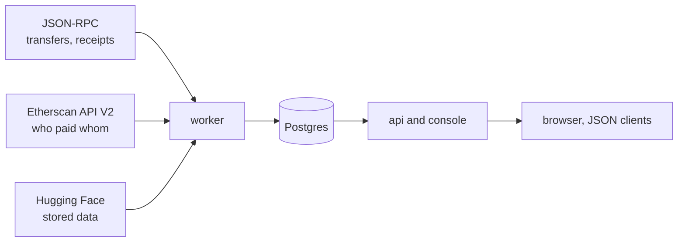

# washtrace

**Finds NFT wash trading on any EVM chain by following the money between wallets,
and says why each trade was flagged.**

Wash trading is trading with yourself: the same person on both sides of a sale,
to fake volume, prop up a price or farm a marketplace's rewards. washtrace reads
every transfer of the collections you watch and who paid whom among the wallets
that traded them, and judges each trade by three graph methods. It runs as two
services over one Postgres: a polling **worker** and a JSON **API** with a
console.

It is the 2023 paper [*Detecting and quantifying wash trading of non-fungible
tokens*](paper/chow-2023-detecting-and-quantifying-nft-wash-trading.pdf) (Chow)
rebuilt on today's systems: the methods are the paper's, the data sources,
marketplaces and three corrections are new.

- **Status:** v0.1.0. Tested against Postgres 17 and anvil 1.5.1; verified on
  Ethereum mainnet against the paper's own example sale.
- **Try it:** the [demo](#quick-start) needs Docker and no keys.
- **Data:** [jonathanmiro97/washtrace-data](https://huggingface.co/datasets/jonathanmiro97/washtrace-data)
  on Hugging Face: six Ethereum collections read from the chain, CC-BY-4.0.

## Where to go

| You want to | Read |
|---|---|
| See it work | [Quick start](#quick-start), then [the console](#the-console) |
| Know what a word on screen means | [The glossary](doc/glossary.md) |
| Know whether to trust a flag | [The methods](doc/methods.md): each on a demo token, the placebo test, what a read cannot see |
| Read a page, or write your own lens | [The console](doc/console.md) |
| Ask for verdicts from code | [Asking for a verdict](#asking-for-a-verdict), then [the API](doc/api.md) |
| Run it on a real chain | [Operating](doc/operating.md): settings, deploying, the worker, what to do when something is wrong, limits; [upgrading](doc/upgrading.md) |
| Use the data | [The dataset](#the-dataset), then [stored data](doc/stored-data.md) |
| Work on the code | [CONTRIBUTING.md](CONTRIBUTING.md) |

## Quick start

Requires Docker with Compose 2.24 or later.

**The demo needs no keys.** It runs a local chain with a scripted market, wash
trading of each kind hidden among honest trades:

```sh
docker compose -f docker-compose.yml -f docker-compose.demo.yml up --build
```

Open http://localhost:8080 and choose **Demo Apes**. Its verdicts arrive about
seven minutes after the seeder finishes: the worker reads the transfers within a
minute, but analyses of one collection are spaced five minutes apart, and the
first ran before any transfer was read. Each row below is one token; the columns
are in the console's order: floor, ceiling, not counted.
[doc/methods.md](doc/methods.md) walks through why each verdict is what it is.
The letters in the headers are the paper's codes for the lenses; they appear
only in URLs, the API and the CSV.

| Token | What happens | Round trips (A) | Linked wallets (AC) | Money loops back (AU) |
|---|---|---|---|---|
| #101 | Sold back and forth between two wallets | flagged | flagged | flagged |
| #102 | Sold round a ring of three wallets, twice | flagged | flagged | flagged |
| #111 | The buyer pays the seller back | – | flagged | flagged |
| #112 | The buyer pays the seller back through a third wallet | – | flagged | flagged |
| #113 | The money comes back through three wallets that never traded | – | – | flagged |
| #114 | One wallet funded both the seller and the buyer | – | flagged | – |
| #116 | The seller and the buyer both paid the same wallet | – | flagged | – |
| #1–#40 | Honest sales, every buyer funded by one exchange | – | – | – |
| #120 | Two loans through Blur Blend, then a sale | – | – | – |
| #130 | Sold once and bought back once | – | – | – |

**When it is done,** the Worker page says "Nothing has failed." and the Demo
Apes overview shows its range, from the floor to the ceiling, under a strip of
the reading's steps, each ticked or marked "not needed".

**To start over,** remove the demo's containers and both volumes:

```sh
docker compose -f docker-compose.yml -f docker-compose.demo.yml down -v
```

`-v` also removes the downloaded stored data, which a real run downloads again.
The demo and a real run share one database, so a real run after the demo would
find the demo collection. If you set `COMPOSE_PROJECT_NAME` or `-p`, pass the
same. To keep the downloads, run `docker compose down`, then
`docker volume rm <project>_db`.

**Against a real chain**, give it an RPC endpoint and an Etherscan key, then
watch a collection from the console or `POST /api/collections`:

```sh
cp .env.example .env    # set WASHTRACE_RPC_1 and WASHTRACE_ETHERSCAN_KEY
docker compose up --build
```

A big collection takes days to read from the chain. **With no keys**, skip the
`cp` and watch one of the six collections in [the dataset](#the-dataset);
Argonauts is the smallest download, about 320 MB:

```sh
curl -X POST http://localhost:8080/api/collections -H 'content-type: application/json' \
  -d '{"chainId": 1, "address": "0x387c41b0b2f1128de44db1bcf8baad085f26392c"}'
```

The worker downloads it and warns that no RPC is set, so only stored data is read
until one is set in Settings. The console and API are on port 8080 of this
machine only; every setting, and how to put it on a public host, is in
[doc/operating.md](doc/operating.md).

## The console

A collection's page leads with **the answer**: the share of its sales that looks
washed, as a range from Round trips (the floor) to Linked wallets (the ceiling).
Every page, from a ring to a single payment, is in
[doc/console.md](doc/console.md), and every word it uses is in
[the glossary](doc/glossary.md).

## Asking for a verdict

Everything the console shows is JSON under `/api`. A transaction's verdict, here
the demo's sale of #114 (its hash is on the token's page), trimmed:

```sh
curl http://localhost:8080/api/transfers/31337/0x083d0b4dc33d0b699b212e551c5195e31efbef22b285456be6c2181f97b05470
```

```jsonc
{
  "washTrade": true,   // Round trips or Linked wallets flags it
  "judged": true,      // an analysis covers it; false means "not judged yet", never clean
  "methods": ["AC"],   // every lens that flagged it
  "transfers": [{
    "tokenId": "114",
    "from": "0x72f1…ebf6",
    "to": "0x28ed…f31b",
    "marketplace": "seaport-1.6",
    "priceWei": "9000000000000000000",
    "flags": {
      "AC": {          // the witness: why Linked wallets flagged it
        "kind": "pair",
        "pair": ["0x72f1…ebf6", "0x28ed…f31b"],
        "middle": "0x8318…67d8",  // the wallet that paid both
        "flowTx": "0xc924…05f9"   // a payment that joins them
      }
    }
  }]
}
```

A transaction washtrace has not read is 404, never `washTrade: false`.

**Not watched yet?** `POST /api/spots` judges one transaction without watching
its collection: [doc/api.md](doc/api.md#spot-checks). What it can and cannot say
is in [doc/methods.md](doc/methods.md#a-spot-check).

## How it works



The worker **ingests** each collection's transfers to the finalized head (a
transfer in a known marketplace's transaction is a sale), **funds** who paid whom
for every wallet that traded and follows that money out, and **analyzes** with
the three methods and your lenses whenever the data changed. The api and console
only read Postgres, so a slow read never slows a page.

Three lenses judge each trade: Round trips (the floor), Linked wallets (the
ceiling) and Money loops back (not counted). The headline is the range from the
floor to the ceiling ([glossary](doc/glossary.md#the-lenses),
[methods](doc/methods.md)). Money loops back still runs, but a placebo test
showed it does not separate wash trading from chance, so it is left out of the
headline. A lens that needs who paid whom and has none says **not run**, never
0%. The test, the thresholds and what a read cannot see are in
[doc/methods.md](doc/methods.md).

## The paper

**[*Detecting and quantifying wash trading of non-fungible tokens*](paper/chow-2023-detecting-and-quantifying-nft-wash-trading.pdf)**
by Jonathan Chow, Singapore Management University, 2023
([slides](paper/chow-2023-detecting-and-quantifying-nft-wash-trading-slides.pdf)).
The top NFT collections by market cap show far less wash trading than the rest,
which points to wash trades the usual detector cannot see: it finds loops in a
token's own transfers, and a trader beats it by paying through wallets that never
touch the token. The paper adds the graph of money between wallets.

| | The paper (2023) | washtrace |
|---|---|---|
| Data sources | Moralis, Footprint Analytics | Any JSON-RPC endpoint, Etherscan API V2 |
| Chains | Ethereum | Any EVM chain |
| Marketplaces | Seaport 1.4 and 1.5 | Seaport 1.1 to 1.6, Blur, LooksRare v2, X2Y2 |
| Money | ETH | ETH, internal transfers, WETH, Blur Pool, and Other tokens if read |
| Whose money | Traders' | Traders', then followed out (wallets out) |

Three corrections, each with a test and set out in
[doc/methods.md](doc/methods.md#what-is-never-counted): a sale's own payment
does not close a loop, custody is not a change of owner, and an exchange is not
a common funder.

It builds on Jung (2022), Liu (2023), hildobby's Dune query (2022), Victor &
Weintraud (2021) and Cao et al. (2016); what each gave it is in
[doc/methods.md](doc/methods.md#the-work-it-builds-on).

## The dataset

Reading a big collection from the chain takes days, so its data is cut once and
published to Hugging Face. When you watch a collection the dataset holds, the
worker downloads it, loads it, then reads on from the chain. The default dataset
holds six Ethereum collections, read through block 26299951 (October 2026):

| Collection | Address | Transfers | Money trail |
|---|---|---|---|
| Argonauts | [`0x387c…392c`](https://etherscan.io/address/0x387c41b0b2f1128de44db1bcf8baad085f26392c) | 1.3 MB | 321.0 MB |
| Terraforms | [`0x4e1f…0e56`](https://etherscan.io/address/0x4e1f41613c9084fdb9e34e11fae9412427480e56) | 2.9 MB | 621.8 MB |
| Meebits | [`0x7bd2…6bc7`](https://etherscan.io/address/0x7bd29408f11d2bfc23c34f18275bbf23bb716bc7) | 6.3 MB | 997.0 MB |
| Dreadfulz | [`0x81ae…5aa8`](https://etherscan.io/address/0x81ae0be3a8044772d04f32398bac1e1b4b215aa8) | 1.6 MB | 368.2 MB |
| BoredApeYachtClub | [`0xbc4c…f13d`](https://etherscan.io/address/0xbc4ca0eda7647a8ab7c2061c2e118a18a936f13d) | 10.9 MB | 955.8 MB |
| dotdotdot | [`0xce25…92c3`](https://etherscan.io/address/0xce25e60a89f200b1fa40f6c313047ffe386992c3) | 1.0 MB | 414.8 MB |

Each file is zstd-compressed CSV; a money trail is two files, and the table adds
their sizes. The [dataset card](https://huggingface.co/datasets/jonathanmiro97/washtrace-data)
gives the columns and a pandas example.

## Contributing

Bug reports, questions and results from your own collections are welcome in
[issues](https://github.com/jonathanchowjh/washtrace/issues). How the code is
built, tested and laid out is in [CONTRIBUTING.md](CONTRIBUTING.md). Thanks to
[sadakosa](https://github.com/sadakosa) for the console's settings, restoring
stored data and money trails from disk, and many fixes to the worker and console.

## Citing

washtrace implements the methods of (Chow, 2023). GitHub's **Cite this
repository** reads [CITATION.cff](CITATION.cff).

```bibtex
@misc{chow2023washtrading,
  author = {Chow, Jonathan},
  title  = {Detecting and quantifying wash trading of non-fungible tokens},
  year   = {2023},
  url    = {https://github.com/jonathanchowjh/washtrace/blob/main/paper/chow-2023-detecting-and-quantifying-nft-wash-trading.pdf}
}
```

The data, if you use it:

```bibtex
@misc{washtracedata,
  author       = {Chow, Jonathan},
  title        = {washtrace data: NFT transfers and money trails},
  year         = {2026},
  howpublished = {Hugging Face},
  url          = {https://huggingface.co/datasets/jonathanmiro97/washtrace-data}
}
```

## License

The code is [MIT](LICENSE). The dataset is CC-BY-4.0. The paper and its slides
in [paper/](paper) are the author's, shared for reading and citing.
