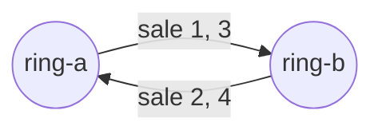
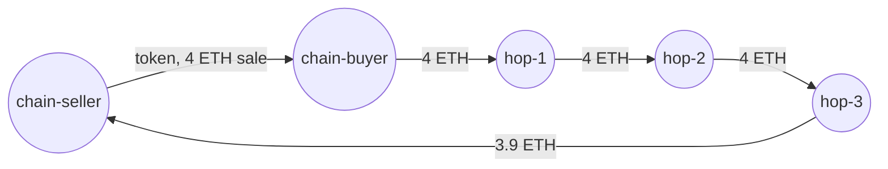
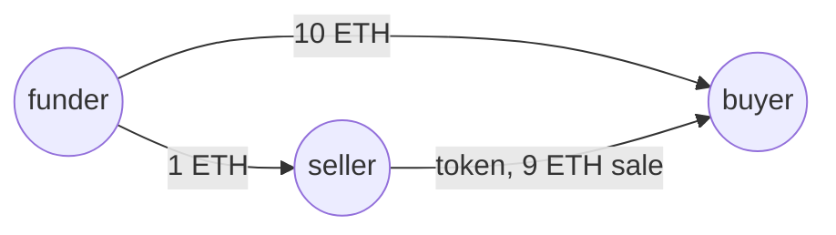

# The methods

For readers who want to know what a flag means before they trust one. It covers the two graphs washtrace builds,
the three methods of the paper, what is never counted, rings, the thresholds, why the headline leaves Money loops
back out, what a read cannot see, and how a spot check is narrower. Each method is shown on a token of the [demo](../README.md#quick-start), so you can open the same
token in the console and see the verdict described here.

## Two graphs

- **The token graph**, one per token. Wallets are nodes, and each transfer of the token is an edge from sender
  to receiver, in time order. Where the data has a gap (the next sender is not the last receiver), a **bridge**
  joins them. A bridge is never flagged and never counted, and the share of bridges is the paper's
  missing-data share. Mints and burns are not trades.
- **The money graph**, one per collection. Each payment between two wallets is an edge from payer to payee: ETH,
  internal ETH, WETH and Blur Pool, and, when they are read, payments in [Other tokens](glossary.md#reading-money).
  The worker reads who paid whom for every trader, then follows the money out `follow.hops` wallets (default 3),
  so a payment can return through wallets that never traded the collection.

A sale's own payment, buyer to seller in the same transaction, is left out of the money graph. Otherwise every
sale would close its own loop.

## SCC A: Round trips

A transfer is flagged when it lies in a strongly connected component (SCC) of its token's graph with at least
two independent cycles (`minCycles`). The cycle count of a component is its cyclomatic number,
E − V + 1 (edges minus wallets plus one).

**Demo #101** is sold back and forth four times between two wallets: 4 edges, 2 wallets, 3 cycles. Flagged.

**Demo #102** goes round a ring of three wallets twice: 6 edges, 3 wallets, 4 cycles. Flagged.

**Demo #130** is sold once and bought back once: 2 edges, 2 wallets, 1 cycle. Collectors do that, so one cycle
is not enough. Clean.

SCC A needs no money data, so it runs on any collection, and the [NFT-70M survey](../CONTRIBUTING.md#nft-70m-survey)
runs it alone.

## SCC AU: Money loops back

The token graph is joined with the money graph between the token's holders. If a holder's money reaches another
holder within 30 wallets (`reachDepth`), that reach becomes one edge in the token's graph. A transfer is flagged
when it lies in a component that the money closes. A component closed by money counts on one cycle, because a
seller paid back by the buyer is one loop.

**Demo #111** is sold once, and the buyer pays the seller back. **Demo #112** pays back through a third wallet.
**Demo #113** pays back through three wallets that never traded the token:

The worker finds #113's way back only because it follows the buyer's money out three wallets. At `follow.hops`
0, as in the paper, it would read the traders alone and miss the loop.

AU follows money one way only, out of each trader. A path back through an exchange or a wallet that paid more
than 25 others (`FOLLOW_FANOUT`) is not followed, so it stays unseen.

## SCC AC: Linked wallets

A transfer is flagged when SCC A flags it, or when its seller and buyer are joined by money within two hops, in
either direction. That covers four cases: one paid the other, both were paid by one funder, both paid one sink,
or a middle wallet sits between them. This is the paper's Figure 8 generalised, and close to the Dune filter
that looks for a buyer and seller funded by the same wallet.

**Demo #114**: one funder paid both the seller and the buyer before the sale.

**Demo #116**: after the sale, the seller and the buyer both paid the same wallet.

AC does not flag #113: its way back is four wallets long, past AC's two hops. AU does not flag #114 or #116:
money never runs from the buyer back to the seller.

## What is never counted

These are the three corrections to the 2023 method. Each has a test.

| Looks like | Why it is not | Demo |
|---|---|---|
| The sale's payment closing a loop | Flows that share a transaction with a transfer are left out of the money graph. | every sale |
| A round trip through a loan | Custody is not a change of owner. A → escrow → A is no hop, so two Blur Blend loans are not a back-and-forth trade. | #120 |
| A common funder that is an exchange | A wallet joined by money to more than 20 of the collection's wallets (`hubDegree`), a known contract, or a wallet with more history than Etherscan pages through is never the middle of an AC path. | #1–#40, all funded by one exchange |

## Rings

A **ring** is the wallets the counted evidence joins: two loops or linked pairs that share a wallet are one ring,
and a pair's middle wallet is in it with the seller and the buyer. It answers "who did this together", not
"how much": a ring flags nothing of its own and is not a fourth method. Its figures are the counted flagged trades
of its witnesses, a trade two of them flag counted once.

- **Only Round trips and Linked wallets make rings.** A witness only Money loops back points at is in none, for
  the reason [the headline leaves it out](#why-the-headline-leaves-money-loops-back-out).
- **A ring is named by its smallest wallet**, its anchor, not by its place. Rings are ranked by the ETH their
  flagged sales moved, and a new analysis can change the ranks, but a ring with the same wallets keeps its
  anchor, so a link to it still opens it.
- **A ring is wallets the evidence ties together, not one person.** Two people can be in one ring because their
  loops cross a wallet, and one person's wallets can sit in two rings that nothing on chain joins.
- **A ring can be large.** Loops chain through shared wallets, so a busy collection can hold one ring of
  thousands of wallets. Its page says how many, and lists the first 500, traders first.

An analysis saves its rings with its flags. One saved before rings existed has its rings worked out from the
witnesses it stored, one collection per worker turn, with nothing analysed again.

## The thresholds

`RULES` in [methods.ts](../packages/detect/src/methods.ts) holds the numbers, each with the sentence that
justifies it. A collection can override any of them through its config route.

| Rule | Value | Where it comes from |
|---|---|---|
| `minCycles` | 2 | Paper §4.3. One cycle is a sale and a buy-back; two is a pattern. |
| `reachDepth` | 30 | Paper §4.4. Money moved through thirty wallets is past what one trader masks. |
| `hubDegree` | 20 | Not in the paper. A wallet joined to more of the collection's wallets than this is an exchange, a bridge or a router. |
| `visitCap` | 20,000 | Not in the paper. A reach search stops after this many wallets, and counts as truncated. |

## Why the headline leaves Money loops back out

The console's headline is the range from Round trips (SCC A) to Linked wallets (SCC AC). Money loops back still
runs and keeps its card, but it is not counted. A placebo test showed it does not separate wash trading from
chance on real data.

**The test.** On Terraforms and dotdotdot, the token side was relabelled at random within bins of 100 wallets of
similar activity, so buyers and sellers became unrelated while the money graph stayed exactly as read. The
relabelling is one-to-one, so SCC A is unchanged. A method that measures wash trading should flag less after
the relabelling.

| Collection | AU real | AU placebo (3 seeds) | AC real | AC placebo (3 seeds) | A |
|---|---|---|---|---|---|
| Terraforms | 71.7% | 74.1 / 75.0 / 74.5% | 47.1% | 36.8 / 37.2 / 36.9% | 32.9% |
| dotdotdot | 59.5% | 58.2 / 58.6 / 58.6% | 23.2% | 18.6 / 18.3 / 17.9% | 14.0% |

- **AU flags as much with unrelated buyers as with the real ones.** Directed reach 30 wallets deep through any
  wallet that is not a hub reaches most of the graph: 6,168 of Terraforms' 11,177 traders' searches hit
  `visitCap`. Its share then follows the parameters, not the data. On Terraforms it moves from 35.6% at
  `hubDegree` 5 to 87.8% at 200.
- **AC passes the test, partly.** It adds 14.2 points over A on Terraforms, and the placebo adds 4.1, so about
  29% of what it adds is chance. On dotdotdot it adds 9.2 points and the placebo 4.3, about 47%. That is the
  README's "between a third and a half".
- **A caveat.** Relabelling within a bin can map one wash wallet onto another, which overstates the placebo
  slightly. That does not rescue a method whose real share sits below its placebo.

The test was a one-off check, run on 2026-11-03 against the published dataset with the engine as it was then.
Its scripts are not in this repository, and later fixes moved some shares by a point or less.

## Shares

A lens's **share** is the part of the trades it judged that it flags. The collection page leads with **sales**.
The analysis also gives **changes of owner** (the paper's Tables 3 and 4) and **volume**.

Read the volume share with care. Sales on Blur, LooksRare v2 and X2Y2 are marked but not priced, so in
Terraforms, Meebits, Dreadfulz and BAYC only 56–68% of sales carry an ETH or WETH price. Wash trading pumps
prices, so a few washed sales dominate the sum, and a collection with any wash trading has a volume share near
100%.

## What it cannot see

- **Money is followed one way.** The worker follows money out of each trader, `follow.hops` deep, only through
  wallets that paid at most 25 others (`FOLLOW_FANOUT`). Following is what finds #113's way back, but an exchange
  or a busy trader is not followed, so a path back through one stays unseen.
- **Reads are a snapshot unless read again is on.** A wallet's money and Other tokens are read once, so a later
  payment is not seen. `follow.reread` reads a trader again when it trades again; wallets loaded from a stored
  money trail and wallets past Etherscan's 10,000-row page limit are never read again. See
  [operating.md](operating.md#reading-traders-again).
- **Other tokens are a fixed list** in the code, not the settings, and without `tokens.payees` a loop whose middle
  wallet was only paid in tokens can be missed.
- **Searches have caps.** A trade's money search stops at 5,000 edges and the share reads "at least". Every cap is
  in [operating.md](operating.md#limits).
- **Sales on Blur, LooksRare v2 and X2Y2 are marked but not priced.** Blur v2 packs the price into bit fields
  washtrace does not decode, and a guess would count as read volume. Their sales count; their volume does not
  ([Shares](#shares)).
- **ERC-1155 is not read.** The methods depend on one token, one holder.

## A spot check

A [spot check](console.md#checking-a-transaction-you-do-not-watch) judges one transaction without watching its
collection: its receipt, each of its tokens' histories, and the money of its sellers and buyers and of any wallet
that paid or was paid by both. It is narrower than a full read, and says so:

- **Round trips** reads the token's whole history to the finalized head, so it gives the answer a full read gives
  with the default rules.
- **Linked wallets** finds a link a full read would. It can't count how many of the collection's wallets a middle
  wallet is linked to, so a middle that moved money with more than 20 wallets makes the answer `atLeast`, never
  clean.
- **Money loops back** needs money followed several wallets out, so it is not run. Neither is a lens using Other
  tokens or the collection's other tokens.

## The work it builds on

- Jung (2022), [*Towards a Web Application to Detect and Analyze Wash Trading in NFT Collections on the Solana Blockchain*](https://wwwmatthes.in.tum.de/file/19apj4nvq7a8m/Sebis-Public-Website/Student-Theses-Guided-Research/Current-Theses-Guided-Researches/TUMKolleg-Sebastian-O.-Jung/Sebastian%20Jung%20Thesis.pdf), TUM: SCC detection on each token's transfer graph, flagged by cycle count: the basis of SCC A.
- Liu (2023), [*NFT Wash Trading Detection*](https://arxiv.org/abs/2305.01543): SCC detection over sales as well as transfers.
- hildobby (2022), [*Ethereum NFTs Wash Trading*](https://dune.com/hildobby/nfts-wash-trading), Dune: a buyer and seller first funded by the same wallet, which SCC AC generalises.
- Victor & Weintraud (2021), [*Detecting and Quantifying Wash Trading on Decentralized Cryptocurrency Exchanges*](https://arxiv.org/abs/2102.07001): SCC detection over the user transaction graph, here applied to money between NFT traders.
- Cao et al. (2016), [*Detecting Wash Trade in Financial Market Using Digraphs and Dynamic Programming*](https://ieeexplore.ieee.org/document/7298451): wash trades as cycles in a directed graph; its volume matching does not carry over, as NFTs are not fungible.

The standards and sources washtrace reads: [ERC-721](https://eips.ethereum.org/EIPS/eip-721),
[Seaport](https://github.com/ProjectOpenSea/seaport) (whose sales it prices) and
[Etherscan API V2](https://docs.etherscan.io/) (who paid whom).
